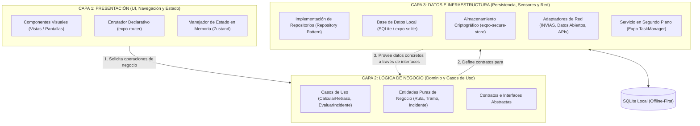

# Proyecto Académico: Monitoreo Vial y Retrasos de Entregas (Colombia)
## Especificación de Arquitectura de Software por Capas y Patrones de Código Limpio

---

### Prólogo Pedagógico: El Enfoque por Capas y Código Limpio

Este documento está diseñado como una guía didáctica de ingeniería de software. Para que un equipo de desarrolladores en formación comprenda no solo *qué herramientas instalar*, sino *por qué y dónde se usa cada una*, el sistema se divide estrictamente en **Tres Capas de Software**.

Cada capa responde a cuatro interrogantes esenciales:
1. **¿Cuál es la responsabilidad de la capa?** (Qué hace y qué tiene prohibido hacer).
2. **¿Qué conceptos teóricos de programación se aplican?** (Fundamentos de ciencias de la computación).
3. **¿Qué tecnologías oficiales de React Native se usan?** (Librerías y módulos).
4. **¿Qué patrones de código limpio (*Clean Code Patterns*) se implementan?** (Estructura y buenas prácticas).

---



---

## 1. CAPA 1: PRESENTACIÓN (UI, NAVEGACIÓN Y ESTADO)

### 1.1 Responsabilidad de la Capa
Es la capa más externa de la aplicación. Su única función es **capturar las interacciones del usuario** (toques, formularios, gestos) y **dibujar la información visual** en pantalla (rutas, alertas, tiempos de entrega).
* **Prohibición de la Capa:** Tiene estrictamente prohibido realizar cálculos matemáticos de demoras, ejecutar sentencias SQL o comunicarse directamente con APIs externas. Solo delega peticiones a la Capa de Negocio.

### 1.2 Conceptos Teóricos Fundamentales para Principiantes
* **El Hilo Principal (*UI Thread / Main Thread*):** Los teléfonos inteligentes refrescan la pantalla 60 o 120 veces por segundo. Todo el dibujo visual ocurre en un único hilo. Si esta capa se sobrecarga con cálculos lentos, la pantalla se congela (*Jank* o *Application Not Responding*).
* **Renderizado Declarativo:** En React Native no se manipula la pantalla de forma manual (imperativa). Se describe el estado visual: *"Si el envío está retrasado, pinta la tarjeta en color rojo; si va a tiempo, en color verde"*.
* **Estado Reactivo en Memoria:** Variables que, al cambiar de valor, notifican automáticamente a la interfaz para que se vuelva a dibujar sin recargar la pantalla completa.

### 1.3 Tecnologías y Dependencias de la Capa
| Tecnología | Categoría | Propósito en la Capa |
| :--- | :--- | :--- |
| `expo-router` | Navegación | Enrutamiento declarativo basado en carpetas (`app/(auth)` y `app/(tabs)`). |
| `react-native` | Interfaz Nativa | Componentes primitivos (`View`, `Text`, `FlatList`, `TextInput`, `TouchableOpacity`). |
| `zustand` | Estado Global | Almacena en memoria el usuario autenticado y la ruta seleccionada sin sobrecarga de código. |
| `@maplibre/maplibre-react-native` | Cartografía Visual | Renderizado en GPU de mapas interactivos, líneas de ruta y marcadores de incidentes. |

### 1.4 Patrones de Código Limpio (*Clean Code Patterns*) Aplicados
1. **Patrón Contenedor y Vista (*Smart & Dumb Components*):**
   * *Componentes Tontos (Presentacionales):* Solo reciben propiedades (`props`) y dibujan botones o tarjetas (ej. `TarjetaIncidente.tsx`). No saben de dónde vienen los datos.
   * *Componentes Contenedores (Pantallas):* Conectan la vista con los casos de uso de la Capa 2 y le pasan los datos listos a las vistas.
2. **Patrón Guardián de Navegación (*Auth Guard Pattern*):**
   * El archivo raíz `_layout.tsx` verifica si existe un token de sesión antes de permitir el acceso a las pantallas privadas. Si no hay sesión, destruye la navegación privada y redirige forzosamente al login.
3. **Flujo Unidireccional de Datos (*Unidirectional Data Flow*):**
   * Los datos bajan hacia los componentes como propiedades y las acciones suben como eventos (`callbacks`), evitando ciclos o inconsistencias visuales.

---

## 2. CAPA 2: LÓGICA DE NEGOCIO Y DOMINIO (SERVICES / CASOS DE USO)

### 2.1 Responsabilidad de la Capa
Es el núcleo intelectual del sistema. Contiene las **reglas de negocio puras** del transporte de carga en Colombia: cómo se calcula un retraso, cuándo una novedad vial bloquea un tramo y qué condiciones determinan el incumplimiento de una entrega.
* **Prohibición de la Capa:** Es 100% agnóstica de frameworks. No debe importar React, ni React Native, ni SQLite, ni Axios. Debe ser código TypeScript puro que podría ejecutarse en una consola de Node.js o en un navegador sin cambios.

### 2.2 Conceptos Teóricos Fundamentales para Principiantes
* **Funciones Puras e Inmutabilidad:** Funciones donde la misma entrada siempre produce la misma salida sin alterar variables globales externas. Evita errores imprevistos en sistemas concurrentes.
* **Geometría Computacional Básica:** La Tierra no es plana; se modela mediante el elipsoide WGS84. Para saber si un derrumbe afecta una carretera, se calcula la distancia ortogonal geodésica entre el punto del incidente y la polilínea de la vía.
* **Complejidad Temporal:** Diseñar algoritmos que evalúen los tramos de ruta de forma eficiente sin realizar comparaciones innecesarias ($O(N)$ vs $O(N^2)$).

### 2.3 Tecnologías y Dependencias de la Capa
| Tecnología | Categoría | Propósito en la Capa |
| :--- | :--- | :--- |
| `TypeScript` | Tipado Estricto | Definición rigurosa de modelos (`Ruta`, `Tramo`, `Incidente`, `Usuario`) e interfaces. |
| `@turf/turf` (módulos específicos) | Algoritmia Espacial | Cálculo de distancias geodésicas (fórmula de Haversine) e intersección de radios de afectación. |
| `date-fns` | Aritmética de Tiempo | Cálculo determinista de diferencias horarias y deltas de retraso en zona horaria de Colombia (`UTC-5`). |

### 2.4 Patrones de Código Limpio (*Clean Code Patterns*) Aplicados
1. **Principio de Responsabilidad Única (SRP - la 'S' de SOLID):**
   * Cada caso de uso realiza exactamente una tarea de negocio:
     * `CalcularRetrasoRutaUseCase.ts` (solo calcula demoras).
     * `EvaluarImpactoIncidenteUseCase.ts` (solo determina si un incidente toca una ruta).
2. **Principio de Inversión de Dependencias (DIP - la 'D' de SOLID):**
   * La lógica de negocio no se acopla a la base de datos real. Define una **interfaz o contrato abstracto** (`IRutaRepository.ts`). La Capa 3 se encarga de implementar dicho contrato.
3. **Objetos de Valor (*Value Objects*):**
   * Tipos de datos inmutables que se auto-validan (ej. `CoordenadaGPS` que valida que la latitud esté entre -90 y 90 y la longitud entre -180 y 180).

---

## 3. CAPA 3: DATOS E INFRAESTRUCTURA (PERSISTENCIA Y RED)

### 3.1 Responsabilidad de la Capa
Es la capa encargada de interactuar con el mundo exterior: la base de datos local del teléfono, el hardware de geolocalización (GPS), el chip criptográfico y los servidores web remotos del gobierno colombiano.
* **Prohibición de la Capa:** No decide qué hacer con los datos; solo sabe cómo guardarlos, leerlos, serializarlos y transmitirlos de forma segura.

### 3.2 Conceptos Teóricos Fundamentales para Principiantes
* **Propiedades ACID en Bases de Datos:**
  * *Atomicidad:* Si una transacción guarda 5 tramos de ruta y falla en el cuarto, se revierte todo para no dejar datos corruptos.
  * *Consistencia, Aislamiento y Durabilidad:* Los datos persisten aunque el celular se quede sin batería de repente.
* **Búsquedas Indexadas vs. Recorridos Secuenciales:**
  * Recorrer una tabla sin índice toma tiempo lineal $O(N)$. Un índice B-Tree en SQLite permite encontrar un incidente en tiempo logarítmico $O(\log N)$.
* **Ciclo de Vida de Procesos y Gestión de Energía:**
  * Los sistemas operativos móviles (Android Doze Mode / iOS Suspended) matan tareas en segundo plano para ahorrar batería. Para capturar coordenadas continuas se requiere un *Foreground Service* nativo.
* **Protocolos de Red y Formatos de Datos:**
  * Peticiones HTTP sin estado (*Stateless*), cabeceras de autorización Bearer, GeoJSON (estándar geográfico) y SODA (Socrata Open Data API).

### 3.3 Tecnologías y Dependencias de la Capa
| Tecnología | Categoría | Propósito en la Capa |
| :--- | :--- | :--- |
| `expo-sqlite` | Persistencia Local | Motor de base de datos relacional embebido para estrategia **Offline-First**. |
| `expo-secure-store` | Seguridad Criptográfica | Cifrado en hardware usando **Android Keystore** y **iOS Keychain** para tokens de sesión. |
| `expo-location` | Hardware | Acceso a chips GNSS (GPS/GLONASS) con balance de precisión y consumo energético. |
| `expo-task-manager` | Concurrencia | Ejecución de tareas periódicas en segundo plano registradas ante el kernel del SO. |
| `@tanstack/react-query` | Red y Caché | Manejo de peticiones asíncronas con reintentos exponenciales automáticos y caché en memoria. |
| `@react-native-community/netinfo` | Conectividad | Detección reactiva de disponibilidad de señal móvil para disparar la sincronización diferida. |

### 3.4 Patrones de Código Limpio (*Clean Code Patterns*) Aplicados
1. **Patrón Repositorio (*Repository Pattern*):**
   * Oculta el origen de los datos. La aplicación le pide "la ruta activa" al repositorio (`RutaRepositoryImpl`), y este decide internamente si la lee de SQLite local o si la descarga de internet si hay señal.
2. **Patrón Adaptador (*Adapter / Mapper Pattern*):**
   * El Geoportal de INVIAS entrega un formato GeoJSON de ArcGIS complejo y lleno de metadatos innecesarios. Un adaptador (`InviasIncidentMapper.ts`) limpia ese payload y lo transforma en la entidad limpia `Incidente` de la Capa 2.
3. **Patrón Data Transfer Object (DTO):**
   * Objetos diseñados exclusivamente para transportar datos desde las APIs de red o tablas de SQLite hacia la aplicación, evitando exponer las estructuras internas de la base de datos.

---

## 4. MODELO DE DATOS RELACIONAL (SQLITE DDL)

El esquema relacional implementado en la **Capa 3** asegura consistencia física y consultas rápidas en el teléfono:

```sql
-- 1. Usuarios / Conductores
CREATE TABLE IF NOT EXISTS usuarios (
    id TEXT PRIMARY KEY,
    nombre TEXT NOT NULL,
    documento TEXT NOT NULL UNIQUE,
    rol TEXT CHECK(rol IN ('conductor', 'operador', 'consulta')) DEFAULT 'conductor',
    token_sesion TEXT,
    creado_en DATETIME DEFAULT CURRENT_TIMESTAMP
);

-- 2. Rutas Planificadas
CREATE TABLE IF NOT EXISTS rutas_entrega (
    id TEXT PRIMARY KEY,
    usuario_id TEXT NOT NULL,
    codigo_manifiesto TEXT,
    origen_nombre TEXT NOT NULL,
    origen_lat REAL NOT NULL,
    origen_lon REAL NOT NULL,
    destino_nombre TEXT NOT NULL,
    destino_lat REAL NOT NULL,
    destino_lon REAL NOT NULL,
    eta_pactado DATETIME NOT NULL,
    eta_recalculado DATETIME,
    distancia_total_km REAL NOT NULL,
    tiempo_estimado_base_min INTEGER NOT NULL,
    estado TEXT CHECK(estado IN ('pendiente', 'en_ruta', 'completada', 'retrasada', 'cancelada')) DEFAULT 'pendiente',
    creado_en DATETIME DEFAULT CURRENT_TIMESTAMP,
    FOREIGN KEY (usuario_id) REFERENCES usuarios(id) ON DELETE CASCADE
);

-- 3. Segmentación en Tramos Viales
CREATE TABLE IF NOT EXISTS tramos_ruta (
    id TEXT PRIMARY KEY,
    ruta_id TEXT NOT NULL,
    orden_secuencia INTEGER NOT NULL,
    origen_segmento_lat REAL NOT NULL,
    origen_segmento_lon REAL NOT NULL,
    destino_segmento_lat REAL NOT NULL,
    destino_segmento_lon REAL NOT NULL,
    via_codigo TEXT,
    distancia_km REAL NOT NULL,
    tiempo_base_min INTEGER NOT NULL,
    FOREIGN KEY (ruta_id) REFERENCES rutas_entrega(id) ON DELETE CASCADE
);

-- 4. Incidentes y Estado Vial
CREATE TABLE IF NOT EXISTS incidentes_viales (
    id TEXT PRIMARY KEY,
    id_fuente_externa TEXT,
    tipo_evento TEXT CHECK(tipo_evento IN ('cierre_total', 'paso_a_un_carril', 'derrumbe', 'mantenimiento', 'accidente', 'clima', 'manifestacion')) NOT NULL,
    gravedad TEXT CHECK(gravedad IN ('baja', 'media', 'alta', 'critica')) NOT NULL,
    descripcion TEXT,
    via_codigo TEXT,
    ubicacion_lat REAL NOT NULL,
    ubicacion_lon REAL NOT NULL,
    radio_afectacion_km REAL DEFAULT 1.0,
    retraso_estimado_min INTEGER DEFAULT 0,
    fuente TEXT NOT NULL,
    estado TEXT CHECK(estado IN ('activo', 'resuelto', 'verificado')) DEFAULT 'activo',
    fecha_reporte DATETIME NOT NULL,
    actualizado_en DATETIME DEFAULT CURRENT_TIMESTAMP
);

-- 5. Búfer de Telemetría GPS Local
CREATE TABLE IF NOT EXISTS telemetria_puntos (
    id INTEGER PRIMARY KEY AUTOINCREMENT,
    ruta_id TEXT NOT NULL,
    latitud REAL NOT NULL,
    longitud REAL NOT NULL,
    velocidad_kmh REAL,
    altitud REAL,
    bateria_nivel REAL,
    timestamp_captura DATETIME NOT NULL,
    sincronizado INTEGER DEFAULT 0,
    FOREIGN KEY (ruta_id) REFERENCES rutas_entrega(id) ON DELETE CASCADE
);

-- 6. Historial de Evaluaciones de Retraso
CREATE TABLE IF NOT EXISTS evaluaciones_retraso (
    id TEXT PRIMARY KEY,
    ruta_id TEXT NOT NULL,
    incidente_id TEXT,
    retraso_delta_min INTEGER NOT NULL,
    causa_principal TEXT NOT NULL,
    timestamp_calculo DATETIME DEFAULT CURRENT_TIMESTAMP,
    FOREIGN KEY (ruta_id) REFERENCES rutas_entrega(id) ON DELETE CASCADE,
    FOREIGN KEY (incidente_id) REFERENCES incidentes_viales(id) ON DELETE SET NULL
);

-- Índices B-Tree Estratégicos (Búsquedas en O(log N))
CREATE INDEX IF NOT EXISTS idx_telemetria_sync ON telemetria_puntos(ruta_id, sincronizado);
CREATE INDEX IF NOT EXISTS idx_incidentes_espacial ON incidentes_viales(ubicacion_lat, ubicacion_lon, estado);
CREATE INDEX IF NOT EXISTS idx_tramos_orden ON tramos_ruta(ruta_id, orden_secuencia);
CREATE INDEX IF NOT EXISTS idx_rutas_estado ON rutas_entrega(usuario_id, estado);
```

---

## 5. CATÁLOGO DE FUENTES Y APIS VIALES DE COLOMBIA

Consumidas e integradas por los adaptadores de la **Capa 3**:

1. **Portal de Datos Abiertos de Colombia (`datos.gov.co`):**
   * *Protocolo:* REST API (SODA con consultas SoQL).
   * *Uso:* Descarga del inventario de peajes concesionados y la Red Vial Nacional de INVIAS para precargar la base de datos local SQLite.
2. **Geoportal INVIAS / Sistema HERMES (`hermes.invias.gov.co`):**
   * *Protocolo:* ArcGIS REST Feature Services (ESRI JSON / GeoJSON).
   * *Uso:* Reportes oficiales en tiempo real del programa `#767` (cierres totales, pasos a un carril por derrumbes y mantenimiento).
3. **Alertas Hidrometeorológicas del IDEAM:**
   * *Protocolo:* Servicios WMS y boletines GeoJSON diarios.
   * *Uso:* Factor de riesgo preventivo por deslizamientos de tierra en zonas de cordillera.
4. **OpenStreetMap (OSM) / OSRM / GraphHopper:**
   * *Protocolo:* REST API abierta.
   * *Uso:* Cálculo de la geometría de la ruta base origen-destino y kilometraje real sin costos de licencias comerciales.
5. **TomTom / HERE Traffic API:**
   * *Protocolo:* REST API protegida con API Keys.
   * *Uso:* Medición de velocidades promedio y demoras dinámicas por congestión en tiempo real.

---

## 6. MOTOR MATEMÁTICO DE CÁLCULO DE RETRASO ($\Delta T$)

Implementado en la **Capa 2 (Lógica de Negocio)**:

$$\text{ETA}_{\text{recalculado}} = \text{Tiempo}_{\text{actual}} + \sum_{i=1}^{n} T_{\text{tramo}_i} + \sum_{j=1}^{m} D_{\text{incidente}_j}$$

$$\Delta T = \text{ETA}_{\text{recalculado}} - \text{ETA}_{\text{pactado}}$$

* Si $\Delta T \le 0$: La entrega se proyecta **A Tiempo**.
* Si $\Delta T > 0$: La entrega presenta un **Retraso Proyectado** de $\Delta T$ minutos, notificando a la Capa 1 para que alerte al transportador y al despachador.

---

## 7. MAPEO FÍSICO DE LA ARQUITECTURA EN EL CÓDIGO (FOLDER STRUCTURE)

Las 3 capas se materializan directamente en la estructura de carpetas de React Native con Expo:

```text
transporte_colombia_rn/
├── app/                           <-- ENRUTADOR DE CAPA 1 (Expo Router)
│   ├── (auth)/                    <-- Pila Pública (login.tsx, register.tsx)
│   ├── (tabs)/                    <-- Pila Privada (rutas.tsx, mapa.tsx, perfil.tsx)
│   └── _layout.tsx                <-- Auth Guard (Verifica token antes de entrar)
│
├── src/
│   ├── presentation/              <-- [CAPA 1: PRESENTACIÓN]
│   │   ├── components/            <-- TarjetaIncidente.tsx, MapaView.tsx, BotonPrimario.tsx
│   │   └── store/                 <-- useAuthStore.ts, useRutaStore.ts (Zustand)
│   │
│   ├── domain/                    <-- [CAPA 2: LÓGICA DE NEGOCIO / DOMINIO]
│   │   ├── models/                <-- Ruta.ts, Incidente.ts, Tramo.ts, Usuario.ts
│   │   ├── repositories/          <-- IRutaRepository.ts, IIncidenteRepository.ts (Contratos)
│   │   └── usecases/              <-- CalcularRetrasoRuta.ts, EvaluarImpactoIncidente.ts
│   │
│   └── data/                      <-- [CAPA 3: DATOS E INFRAESTRUCTURA]
│       ├── datasources/
│       │   ├── local/             <-- SQLite (database.ts, tables.ts)
│       │   ├── remote/            <-- InviasApiService.ts, DatosAbiertosService.ts
│       │   └── secure/            <-- SessionStorage.ts (expo-secure-store)
│       ├── mappers/               <-- InviasIncidentMapper.ts (Transforma GeoJSON a Entidad)
│       └── repositories/          <-- RutaRepositoryImpl.ts, IncidenteRepositoryImpl.ts
│
├── app.json                       <-- Configuración declarativa de Expo y permisos GPS
├── package.json                   <-- Dependencias oficiales del proyecto
└── tsconfig.json                  <-- Configuración de TypeScript y alias de rutas
```
