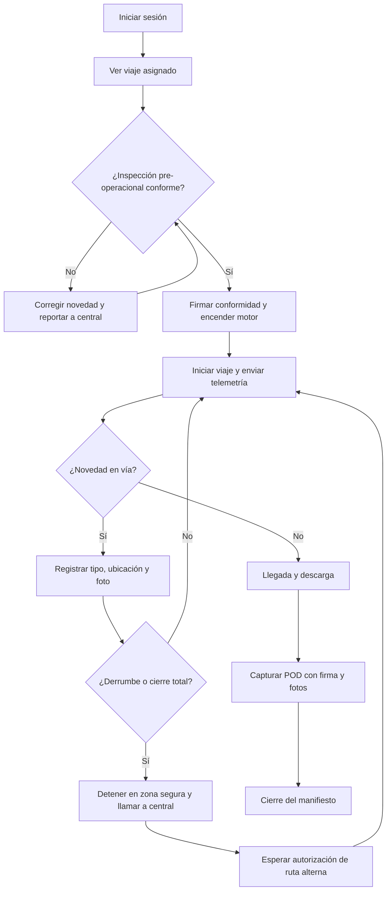
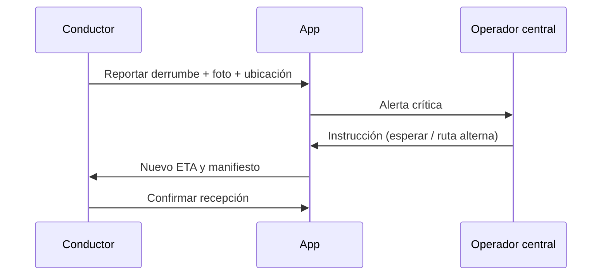

# Manual de Procedimiento para Conductores en Carretera

**Task:** SOF-09 · **Versión:** 1.0 · **Fecha:** 2026-11-25 · **Público:** Conductores RNDC

Este manual describe el flujo operativo desde el inicio de jornada hasta la entrega con firma digital. Sigue los pasos en orden; cada uno queda registrado en el manifiesto y es auditable por la central.

## 1. Flujo general

## 2. Antes de salir

### 2.1 Acceso

1. Abre la app e ingresa con `conductor@transporte.com` y tu contraseña.
2. En **Mis Rutas** verifica que aparezca un solo viaje activo. Si aparecen dos, no aceptes ninguno y reporta a la central.

> Ilustración 1: pantalla **Mis Rutas** con una tarjeta de viaje activo y el botón **Iniciar inspección**.

### 2.2 Inspección pre-operacional

Registra cada punto del contrato `IVehicleInspection`:

| Ítem | Acción | Si falla |
| :--- | :--- | :--- |
| Frenos | Probar freno de pie y de parqueo | No iniciar viaje; reportar mecánica |
| Nivel de aceite | Revisar varilla con motor apagado | No iniciar viaje; reponer nivel |
| Presión de llantas | Verificar llantas y repuesto | Corregir presión antes de salir |
| Luces | Probar faros, direccionales, frenos y reversa | No circular de noche sin corrección |
| Kit de carreteras | Confirmar triángulos, extintor, botiquín y gato | Solicitar reposición |
| SOAT | Verificar vigencia y fecha de vencimiento | No iniciar viaje si está vencido |
| Revisión técnico-mecánica | Verificar vigencia | No iniciar viaje si está vencida |

Finalmente dibuja tu **firma de conformidad**. El sistema guarda `fechaInspeccion` y solo entonces habilita **Encender motor**.

> Ilustración 2: checklist con casillas marcadas y recuadro de firma del conductor.

## 3. Durante el viaje

### 3.1 Inicio y telemetría

1. Toca **Iniciar viaje**. La ruta pasa a `en_ruta`.
2. Mantén el teléfono con ubicación activa. La app envía puntos de telemetría cada intervalo configurado.
3. Si no hay internet, verás **Sin conexión**. Los puntos se guardan en el dispositivo y se envían automáticamente al reconectar. No cierres la app ni borres datos.

### 3.2 Reportar una novedad en vía

1. Toca **Reportar novedad**.
2. Selecciona el tipo: cierre total, paso a un carril, derrumbe, mantenimiento, accidente, clima o manifestación.
3. Describe qué ocurre, toma una foto si es seguro y confirma la ubicación automática.
4. Envía. La central recibe la alerta con latitud, longitud y hora.

> Ilustración 3: formulario de novedad con selector de tipo, foto y coordenadas.

### 3.3 Ante un derrumbe o cierre total

1. **Detén el vehículo en zona segura**, enciende las luces de emergencia y coloca los triángulos.
2. No intentes pasar si el reporte indica cierre total o no hay paso autorizado.
3. Reporta la novedad con tipo **Derrumbe** o **Cierre total** y adjunta foto desde distancia segura.
4. Llama a la central y espera autorización. La central recalculará el ETA con el impacto del incidente.
5. Si autorizan ruta alterna, recibe el nuevo manifiesto antes de reanudar la marcha.
6. Si la orden es esperar, registra el tiempo de espera como novedad adicional.

## 4. En la entrega

### 4.1 Prueba de entrega digital (POD)

1. Al llegar, estaciona en zona autorizada y apaga el motor.
2. Toca **Registrar entrega**.
3. Captura la **firma del receptor** en el recuadro.
4. Digita **nombre completo** y **cédula** del receptor.
5. Agrega observaciones si hay faltantes o daños.
6. Toma entre una y tres fotos de la carga entregada.
7. Confirma la ubicación (la app toma latitud y longitud automáticamente) y envía.

El registro queda como `IProofOfDelivery`: firma en Base64, datos del receptor, observaciones, URIs de fotos, `fechaHoraEntrega` y coordenadas.

> Ilustración 4: pantalla de firma del receptor con datos, fotos y confirmación de ubicación.

### 4.2 Cierre

1. Verifica que el manifiesto muestre **Completada**.
2. Si el envío queda pendiente por falta de red, conserva el comprobante local hasta que aparezca **Sincronizado**.
3. Reporta a la central cualquier novedad de descarga antes de cerrar la jornada.

## 5. Reglas que no se negocian

- No iniciar el motor sin la firma de conformidad de la inspección.
- No aceptar un segundo viaje mientras exista uno activo.
- No circular con SOAT o revisión técnico-mecánica vencidos.
- No borrar la app ni desinstalarla con entregas pendientes de sincronización.
- No omitir fotos cuando la mercancía sea refrigerada o peligrosa.
