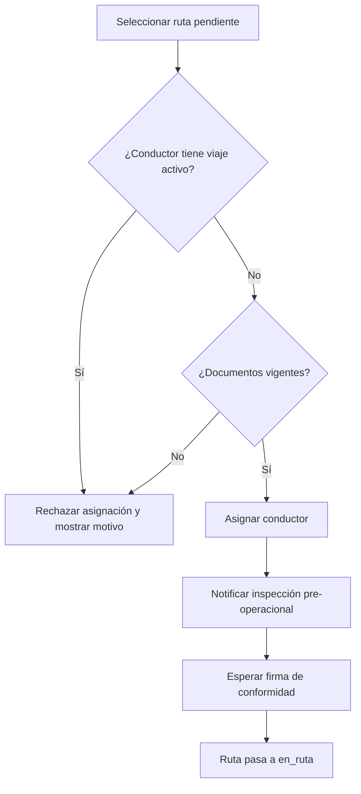
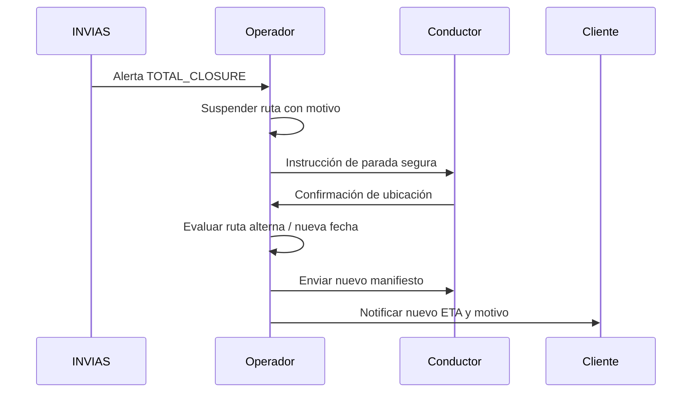

# Manual de Gestión y Despacho para Operadores de Central

**Task:** SOF-10 · **Versión:** 1.0 · **Fecha:** 2026-11-25 · **Público:** Operadores centrales

Este manual cubre la creación del despacho, la asignación de conductores, la interpretación de alertas viales del INVIAS y la contingencia por cierre total de carretera.

## 1. Acceso y responsabilidades

Ingresa con `operador@transporte.com` y tu contraseña. Desde la central puedes:

- Crear despachos con manifiesto `MAN-XXXXX`, mercancía y tipología vehicular.
- Asignar conductores y revisar disponibilidad.
- Consultar alertas del INVIAS y novedades reportadas en vía.
- Suspender rutas con motivo justificado y recalcular ETA.
- Notificar al cliente el estado de su remesa.

**Regla de oro:** ninguna ruta se despacha sin manifiesto, sin revisión pre-operacional del conductor y sin verificación de alertas vigentes en el corredor.

## 2. Creación de despacho

1. Abrir **Mis Rutas** → **Nuevo despacho**.
2. Ingresar el código de manifiesto con formato `MAN-XXXXX`. ej. `MAN-10425`.
3. Definir origen, destino, corredor (ver `docs/catalogo_vias_colombia.md`) y hora de salida.
4. Registrar `CargoDetails`: tipo de mercancía (seca, refrigerada o peligrosa), peso en kg, volumen en m3 y valor asegurado en COP.
5. Seleccionar `VehicleType`:

| Tipología | Descripción | Categoría de peaje |
| :--- | :--- | :--- |
| C2 | Camión sencillo 2 ejes | II |
| C3 | Dobletroque 3 ejes | III |
| C3S3 | Tractocamión con semirremolque 3 ejes | V |

6. Guardar. El sistema calcula peajes estimados con `ITollStation.tarifas` y genera la ruta en estado `pendiente`.

> Ilustración 1: formulario de despacho con manifiesto, mercancía y tipología vehicular.

## 3. Asignación de conductores

Verificar antes de asignar:

- El conductor **no** tiene otro viaje en estado `en_ruta` o `en_suspension`.
- SOAT y revisión técnico-mecánica vigentes confirmadas por el conductor.
- El tipo de vehículo coincide con la mercancía (refrigerada o peligrosa requiere configuración autorizada).
- El conductor recibió el manifiesto y las instrucciones del corredor.

Si el conductor ya tiene un viaje activo, la asignación se bloquea con el mensaje: **"Ya tienes un viaje activo"**. No se permite excepción manual.

## 4. Alertas de retraso vial del INVIAS

### 4.1 Tipos y lectura

| Incidente | Severidad típica | Acción inicial |
| :--- | :--- | :--- |
| `TOTAL_CLOSURE` | Crítica | Suspender ruta y abrir contingencia |
| `LANDSLIDE` | Alta/Crítica | Confirmar paso, recalcular ETA |
| `ONE_LANE_PASS` | Media | Avisar al conductor, sumar impacto |
| `MAINTENANCE` | Media | Verificar ventana y desvío |
| `ACCIDENT` | Alta | Confirmar estado de la vía y seguridad del conductor |
| `WEATHER` | Media/Alta | Evaluar visibilidad y pendientes |
| `PROTEST` | Alta | Evitar zona, reubicar parada segura |

La fuente oficial es el canal #767 / portal de INVIAS y el tablero por corredor del MinTransporte. Registra siempre hora de reporte, PK o coordenada y fuente.

### 4.2 Procedimiento de alerta

1. Abrir la bandeja de **Alertas viales**.
2. Verificar que el corredor afectado intersecta la ruta activa.
3. Correlacionar con la telemetría del conductor (última posición antes del incidente).
4. Registrar el incidente con tipo, descripción, severidad e impacto estimado en minutos.
5. El motor de retrasos calcula `recalculatedEta` y `deltaMinutes`.
6. Notificar al conductor y publicar el nuevo ETA en el rastreo público del cliente.

### 4.3 Suspensión de ruta

- **Con motivo justificado:** seleccionar **Suspender**, escribir la causa (ej. "Derrumbe en Km 42, reporte INVIAS 14:20") y adjuntar fuente. La ruta pasa a `en_suspension`; el cliente ve el motivo.
- **Sin motivo:** el sistema bloquea la acción con **"La suspensión requiere un motivo justificado"**. No se permite suspender en blanco.

## 5. Contingencia por cierre total

### 5.1 Pasos obligatorios

1. Confirmar el cierre con fuente oficial (#767 o tablero MinTransporte) y hora de vigencia.
2. Suspender la ruta con motivo justificado y severidad `CRITICAL`.
3. Llamar al conductor, confirmar que está en zona segura y registrar su ubicación.
4. Evaluar:
   - **Ruta alterna disponible:** recalcular distancia, peajes y ETA; emitir nuevo manifiesto; notificar al cliente.
   - **Sin alterna:** mantener `en_suspension`, reprogramar salida y escalar a supervisión.
5. Documentar en el historial del manifiesto: incidente, decisión, hora y responsable.
6. Reanudar solo con autorización y firma de conformidad vigente del conductor.

### 5.2 Matriz de escalamiento

| Situación | Tiempo de reacción | Escalar a |
| :--- | :--- | :--- |
| Cierre total con mercancía refrigerada | Inmediato | Supervisión operativa + cliente |
| Cierre total con carga peligrosa | Inmediato | Seguridad vial + autoridad local |
| Derrumbe sin paso autorizado | 15 min | INVIAS (#767) |
| Desconexión del conductor > 30 min | 15 min | Supervisor de flota |
| Suspensión superior a 4 h | 1 h | Gerencia de operaciones |

## 6. Cierre de jornada

- Revisar que todas las rutas activas tengan telemetría reciente.
- Verificar POD recibidos con firma, cédula, fotos y coordenadas.
- Confirmar que no existan entregas pendientes de sincronización.
- Archivar comprobantes de peaje por categoría y dejar el manual de corredores actualizado si detectaste cambios de tarifa.

> Ilustración 2: panel de operador con alertas, estado de rutas y bandeja de POD pendientes.
